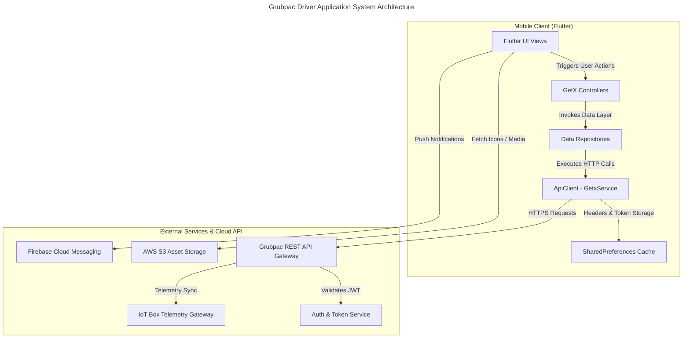
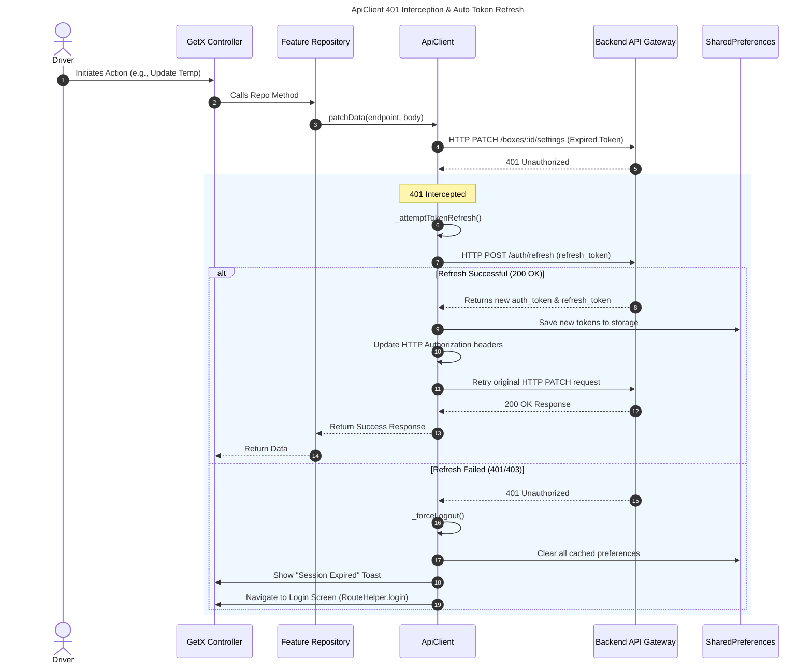
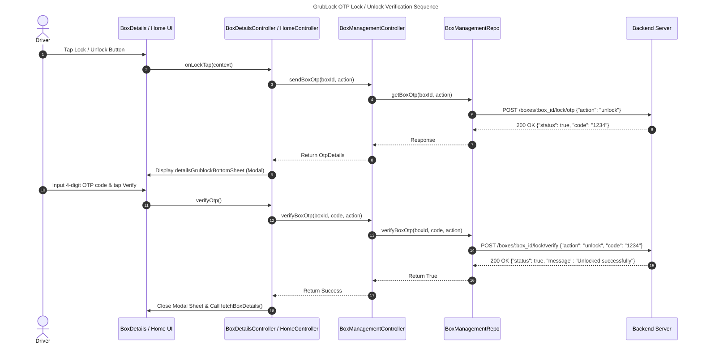
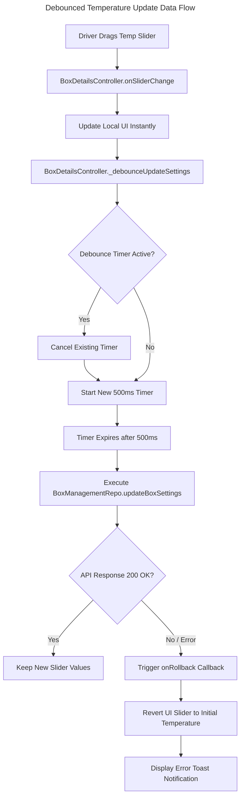

# Grubpac Driver Application - Comprehensive System & Technical Documentation

## 1. Executive Summary & Application Overview

### 1.1 Overview
The **Grubpac Driver Application** (`grubpac_driver`) is a production-grade, cross-platform Flutter mobile application designed for food delivery drivers operating Grubpac's smart thermal delivery boxes. The application bridges driver operations with backend cloud infrastructure and IoT box hardware telemetry, enabling real-time dual-zone thermal management, remote OTP security locking, device diagnostics, and automated session persistence.

### 1.2 Key Capabilities
- **Dual-Zone Thermal Management**: Dynamic adjustment of Zone 1 and Zone 2 target temperatures (-5°C to +25°C) with debounced backend synchronization and immediate visual feedback.
- **GrubLock Security Subsystem**: Time-bound OTP-based box lock and unlock verification for secure compartment access during transit.
- **Telemetry & Telematics Monitoring**: Live display of box battery levels, ambient temperature, 4G/Cellular status, Wi-Fi status, Bluetooth connectivity, memory usage, ADAS, and BoxCam states.
- **Automated Session Persistence & Token Refresh**: Single source of truth authentication architecture featuring automatic 401 token refresh interception and seamless error recovery.
- **QR Box Registration & Scanning**: Integrated QR code camera scanner for registering and connecting smart boxes to driver accounts.
- **Notification & Alert Hub**: Real-time logging and display of thermal threshold warnings, low battery alerts, and system disconnect events.

---

## 2. Architecture & Design Principles

### 2.1 Architecture Overview (Reference: `app_arch.md`)
The application is built on **Clean Architecture** principles combined with the **GetX State Management** pattern:

```text
                        ┌─────────────────────────┐
                        │      UI / Screen        │
                        └────────────┬────────────┘
                                     │
                                     ▼
                        ┌─────────────────────────┐
                        │     GetxController      │
                        └────────────┬────────────┘
                                     │
                                     ▼
                        ┌─────────────────────────┐
                        │       Repository        │
                        └────────────┬────────────┘
                                     │
                                     ▼
                        ┌─────────────────────────┐
                        │        ApiClient        │
                        └────────────┬────────────┘
                                     │
                                     ▼
                        ┌─────────────────────────┐
                        │   SharedPreferences     │
                        └─────────────────────────┘
```

- **Single Source of Truth**: Authentication tokens and session metadata are strictly owned by `ApiClient` and backed by `SharedPreferences` (`AppPreference`).
- **Reactive State Flow**: Feature controllers update reactive UI properties and notify listeners using `update()` or GetX observables.
- **Feature Package Isolation**: Feature packages (`auth`, `box_details`, `dashboard`, `home_section`, `settings_section`, `help_section`) operate independently without direct package-to-package cross-imports. Shared state transitions occur exclusively via repositories or global dependency lookup (`Get.find()`).

### 2.2 System Architecture Diagram



---

## 3. Complete API Specification & Endpoint Reference

All network requests are directed to `AppConstants.baseUrl` (`https://43.204.34.10/api/v1`) using standard JSON (`application/json; charset=UTF-8`) or `multipart/form-data`.

### 3.1 Authentication & Session Endpoints

| Endpoint | Method | Purpose | Request Body | Headers |
|---|---|---|---|---|
| `/delivery-mobile/auth/check-account` | `POST` | Check if phone/email exists | `{"type": "phone", "body": "+1234567890"}` | `Content-Type: application/json` |
| `/delivery-mobile/auth/send-otp` | `POST` | Request login OTP | `{"type": "phone", "body": "+1234567890"}` | `Content-Type: application/json` |
| `/delivery-mobile/auth/verify-otp` | `POST` | Verify login OTP code | `{"type": "phone", "body": "+1234567890", "otp": "1234"}` | `Content-Type: application/json` |
| `/delivery-mobile/auth/login` | `POST` | Existing user password login | `{"type": "phone", "body": "+1234567890", "password": "pass"}` | `Authorization: Bearer <token>` |
| `/delivery-mobile/auth/set-password` | `POST` | Set password after initial OTP | `{"type": "phone", "body": "...", "password": "...", "auth_token": "..."}` | `Content-Type: application/json` |
| `/delivery-mobile/auth/refresh` | `POST` | Auto-refresh expired JWT | `{"refresh_token": "<refresh_token>"}` | `Content-Type: application/json` |
| `/delivery-mobile/auth/logout` | `POST` | Invalidate current session | `{}` | `Authorization: Bearer <token>` |

### 3.2 Password Recovery Endpoints

| Endpoint | Method | Purpose | Request Body |
|---|---|---|---|
| `/delivery-mobile/auth/forget-password/otp/send` | `POST` | Send reset OTP | `{"type": "email", "body": "driver@example.com"}` |
| `/delivery-mobile/auth/forget-password/otp/verify` | `POST` | Verify reset OTP | `{"type": "email", "body": "...", "otp": "1234"}` |
| `/delivery-mobile/auth/forget-password/set-password` | `POST` | Save new password | `{"type": "email", "body": "...", "password": "...", "auth_token": "..."}` |

### 3.3 Smart Box Management Endpoints

| Endpoint | Method | Purpose | Request Body / Query |
|---|---|---|---|
| `/delivery-mobile/boxes` | `GET` | Fetch assigned boxes list | N/A |
| `/delivery-mobile/boxes` | `POST` | Register new box via QR | `{"scanned_code": "<box_qr_code>"}` |
| `/delivery-mobile/boxes/:box_id` | `GET` | Get detailed box telemetry | N/A |
| `/delivery-mobile/boxes/:box_id/settings` | `PATCH` | Update box settings | `{"zone_1_temp": 12, "is_dual_zone": true}` |
| `/delivery-mobile/boxes/:box_id/connection` | `POST` | Connect box Bluetooth/Cellular | `{}` |
| `/delivery-mobile/boxes/:box_id/connection` | `DELETE` | Disconnect box | `{}` |
| `/delivery-mobile/boxes/:box_id` | `DELETE` | Remove box from driver account | N/A |
| `/delivery-mobile/boxes/:box_id/lock/otp` | `POST` | Request GrubLock OTP code | `{"action": "unlock"}` |
| `/delivery-mobile/boxes/:box_id/lock/verify` | `POST` | Verify GrubLock OTP code | `{"action": "unlock", "code": "1234"}` |
| `/simulator/boxes/:box_id/health` | `GET` | Fetch simulator health stats | N/A |

### 3.4 Driver Profile & Support Endpoints

| Endpoint | Method | Purpose | Request Body / Multipart |
|---|---|---|---|
| `/delivery-mobile/profile` | `GET` | Fetch driver profile info | N/A |
| `/delivery-mobile/account` | `PATCH` | Update driver profile info | Multipart (`name`, `image` file) |
| `/delivery-mobile/account` | `PUT` | Change password | `{"old_password": "...", "new_password": "..."}` |
| `/delivery-mobile/account` | `DELETE` | Delete account permanently | `{"password": "..."}` |
| `/delivery-mobile/notification` | `GET` | Get alert notifications | N/A |
| `/delivery/support/category` | `GET` | Fetch support FAQ categories | N/A |

---

## 4. Code Structure & Module Breakdown

The project source tree is organized logically into high-level directories under `lib/`:

```
lib/
├── common_components/        # Reusable UI widgets (buttons, loaders, text, temp sliders)
├── core/                     # Core infrastructure, themes, constants, utilities
│   ├── exceptions/           # Custom exception definitions (Failure)
│   ├── preference/           # SharedPreferences wrapper (AppPreference, PrefKey)
│   ├── theme/                # Light and Dark theme configurations (AppTheme)
│   └── utils/                # Constants, strings, toasts, date formatters, validation
├── data/                     # Global data layer
│   ├── api/                  # ApiClient, ApiChecker, MultipartBody
│   └── model/                # ErrorResponse, ResponseModel
├── helper/                   # Application helper functions
│   ├── get_di.dart           # Dependency Injection setup
│   ├── navigation.dart       # Navigation wrapper
│   └── route_helper.dart     # Named route definitions & GetPage configuration
├── screens/                  # Feature Modules
│   ├── auth/                 # Login, OTP, Password Setup/Reset views, controllers & repo
│   ├── box_details/          # Interactive thermal box details, sliders, lock modal
│   ├── dashboard/            # Bottom navigation container
│   ├── fallback_screens/     # Maintenance, Update, No Internet, 500 error screens
│   ├── help_section/         # Support FAQs & Contact screen
│   ├── home_section/         # Dashboard home view, box connection flows
│   ├── scan_box/             # QR scanner for box pairing
│   ├── settings_section/     # Profile, Box Management, Alerts, App Settings
│   └── splash/               # Splash screen & initial app configuration check
├── firebase_options.dart     # Generated Firebase configuration
└── main.dart                 # Application entry point
```

---

## 5. Key System Workflows & Sequence Diagrams

### 5.1 Automatic Token Refresh & Response Interception
The `ApiClient` acts as a central guard for all network transactions. If an API request returns a `401 Unauthorized` status code, the client pauses execution, attempts a refresh call using the stored refresh token, and retries the initial request seamlessly.



---

### 5.2 GrubLock OTP Lock/Unlock Sequence
GrubLock allows drivers to lock or unlock the delivery compartment by requesting a time-sensitive OTP and validating it against the backend.



---

### 5.3 Debounced Temperature Telemetry Adjustment Flow

To optimize network usage during rapid temperature slider interactions, `BoxDetailsController` uses a **500ms debounce timer** before executing backend PATCH calls:



---

## 6. Detailed Catalog of Core Classes & Modules

### 6.1 `ApiClient` ([api_client.dart](file:///Users/robin/Desktop/Grubpac/driver_app-zabee_working/lib/data/api/api_client.dart#L21))
- **Role**: Core network service extending `GetxService`.
- **Properties**:
  - `appBaseUrl`: String base URL (`https://43.204.34.10/api/v1`).
  - `sharedPreferences`: Singleton instance for persistent token lookup.
  - `timeoutInSeconds`: 30-second network call timeout threshold.
  - `token`: Cached Bearer authorization token.
  - `_isHandlingUnauthorized`: Boolean guard preventing multi-threaded redirect loops on 401/403 errors.
  - `_refreshFuture`: Thread-safe Future holding active token refresh requests.

### 6.2 `BoxDetailsController` ([box_details_controller.dart](file:///Users/robin/Desktop/Grubpac/driver_app-zabee_working/lib/screens/box_details/controller/box_details_controller.dart#L24))
- **Role**: Manages telemetry view state and interactive compartment controls.
- **Key State Variables**:
  - `firstBattery` / `secondBattery`: Integer target temperatures for Zone 1 and Zone 2.
  - `dualZoneSwitch`: Controls dual-zone thermal mode.
  - `advertSwitch`: Toggles box digital advertising display.
  - `ioniserSwitch`: Controls air ioniser purification module.
  - `sliderController`: InteractiveSliderController for UI temperature drag events.

### 6.3 `BoxManagementController` ([box_management_controller.dart](file:///Users/robin/Desktop/Grubpac/driver_app-zabee_working/lib/screens/settings_section/box_management/controller/box_management_controller.dart#L23))
- **Role**: Global box state owner maintained as a permanent GetX controller (`Get.put(..., permanent: true)`).
- **Responsibilities**:
  - Maintains `boxes` list (`List<BoxInfo>`).
  - Manages box connection status synchronization across Home and Box Details screens.
  - Handles OTP dispatch (`sendBoxOtp`) and validation (`verifyBoxOtp`).

### 6.4 `AppPreference` ([app_preferences.dart](file:///Users/robin/Desktop/Grubpac/driver_app-zabee_working/lib/core/preference/app_preferences.dart#L6))
- **Role**: Static wrapper around `SharedPreferences`.
- **Keys Managed**:
  - `PrefKey.token`: JWT authentication token.
  - `PrefKey.refreshToken`: JWT refresh token.
  - `PrefKey.phone` / `PrefKey.countryCode`: Driver contact information.
  - `PrefKey.name`: Driver display name.
  - `PrefKey.isDark`: Theme mode flag.

---

## 7. Configuration, Dependencies & Environment Settings

### 7.1 Key Package Dependencies (`pubspec.yaml`)
- `get` (`^4.6.6`): Dependency injection, routing, and reactive state management.
- `http` (`^1.2.0`): HTTP requests & response streaming.
- `shared_preferences` (`^2.2.2`): Local key-value persistence.
- `flutter_screenutil` (`^5.9.3`): Adaptive UI resolution scaling.
- `toastification` (`^2.3.0`): Modern toast notifications.
- `interactive_slider` (`^0.4.0`): Interactive visual temperature sliders.
- `timer_count_down` (`^1.0.1`): Countdown timer for OTP resend limits.
- `image_picker` (`^1.1.2`): Gallery and camera image selection for profile uploads.
- `firebase_core` (`^3.6.0`): Core Firebase infrastructure initialization.

### 7.2 System Configurations
- **Supported Orientations**: Enforced portrait orientation (`DeviceOrientation.portraitUp`, `DeviceOrientation.portraitDown`) in `main.dart`.
- **SSL Certificate Handling**: Standardized custom `HttpOverrides` (`MyHttpOverrides`) to ensure reliable network handshake compatibility across development environments.
- **Web Scaling**: System text scaling locked (`MediaQuery.withNoTextScaling`) to guarantee consistent UI layout fidelity across disparate device font scale settings.

---

## 8. Operational Driver User Guide

### 8.1 Driver Onboarding & Authentication
1. **Launch App**: The app executes splash checks in `SplashScreen`. If a valid token exists, it routes to `DashboardScreen`; otherwise, it displays `LoginScreen`.
2. **Phone/Email Input**: The driver enters their contact info. `AuthRepo.checkAccountApi()` determines whether the user is new or existing.
3. **OTP Verification**: Driver inputs the 4-digit code. On verification, `saveUserToken()` persists the credentials.
4. **Password Setup**: First-time users set a secure password via `SetPasswordScreen`.

### 8.2 Pairing & Managing Smart Delivery Boxes
1. **Scan QR Code**: From the Dashboard Home, tap **"Add Box"** to launch `ScanBoxScreen`. Point the camera at the QR code printed on the delivery box.
2. **Box Registration**: `BoxManagementRepo.registerbox()` binds the box ID to the driver's profile.
3. **Connect Box**: Select **"Connect Box"** from the home screen box card to establish Bluetooth/Cellular telemetry link.

### 8.3 Adjusting Thermal Compartments & GrubLock
1. **Open Box Details**: Tap on a box card to view `BoxDetailsScreen`.
2. **Adjust Temperature**: Drag the interactive slider or tap preset temperature buttons. The app immediately updates the UI and sends a debounced update request to the server.
3. **GrubLock Lock/Unlock**: Tap the GrubLock button, request an OTP code, enter the received 4-digit code in the modal sheet, and tap **Verify**.

---

## 9. Developer Onboarding & Testing Protocols

### 9.1 Local Development Environment Setup
1. Ensure Flutter SDK (>=3.0.0) is installed.
2. Clone repository and run dependency installation:
   ```bash
   flutter pub get
   ```
3. Launch application on iOS Simulator or Android Emulator:
   ```bash
   flutter run
   ```

### 9.2 Adding a New Feature Module
When implementing a new feature in `lib/screens/`:
1. Create module directory structure: `controller/`, `repo/`, `view/`, `widget/`.
2. Implement Repository consuming `ApiClient`.
3. Create Controller extending `GetxController`.
4. Register Repository and Controller in `lib/helper/get_di.dart`:
   ```dart
   Get.lazyPut(() => NewFeatureRepo(apiClient: Get.find(), sharedPreferences: Get.find()), fenix: true);
   Get.lazyPut(() => NewFeatureController(repo: Get.find()), fenix: true);
   ```
5. Add named route string and `GetPage` in `lib/helper/route_helper.dart`.

---

## 10. Quality Assurance & Error Handling Protocols

- **Network Resilience**: `ApiClient` catches exceptions and wraps responses in standard `Response(statusCode: 1, statusText: noInternetMessage)`.
- **Global Toast Alerts**: UI exceptions are processed via `AppUtils.apiErrorHandler(e)` and surfaced as styled warning/error toasts via `AppToast`.
- **State Rollback Safeguard**: All optimistic UI changes (dual-zone toggle, temperature slider, ioniser switch) carry explicit `onRollback` closures that revert UI state if network calls fail or time out.
