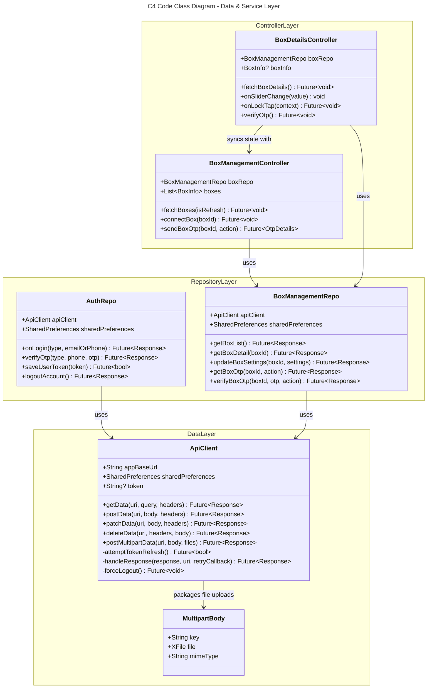
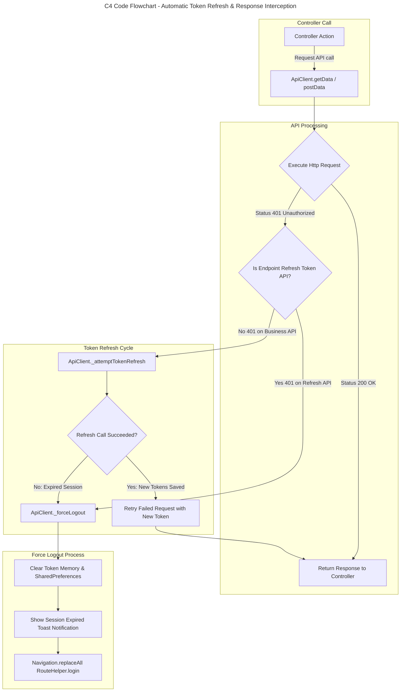
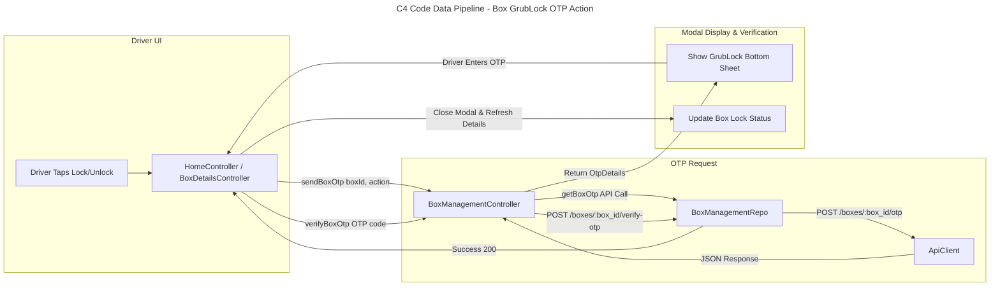

# C4 Code Level: Grubpac Driver Application (`driver_app-zabee_working`)

## Overview

- **Name**: Grubpac Driver Mobile Application (`grubpac_driver`)
- **Description**: Flutter cross-platform mobile application for Grubpac drivers to manage smart thermal delivery boxes, control dual-zone temperatures, unlock/lock boxes via OTP validation, receive alert notifications, manage driver profile, and interact with backend REST APIs.
- **Location**: `file:///Users/robin/Desktop/Grubpac/driver_app-zabee_working/lib`
- **Language**: Dart (Flutter Framework)
- **Purpose**: Acts as the driver-facing client application, handling authentication, persistent session token management with auto-refresh, box connectivity (Bluetooth/Cellular status), thermal telemetry display, interactive box controls, and state management using GetX and GetIt DI.

---

## Session & Architecture Alignment (Reference: `app_arch.md`)

The application architecture follows a centralized single source of truth model for session management and state reactivity:

- **Single Source of Truth**: `ApiClient` and `SharedPreferences` maintain token storage, refresh logic (`_attemptTokenRefresh`), and header updates.
- **Dependency Injection**: `lib/helper/get_di.dart` initializes singletons (`ApiClient`, `SharedPreferences`, `AuthRepo`, `BoxManagementRepo`, `ProfileRepo`, `AlertRepo`) and puts core controllers (`BoxManagementController`, `ProfileDetailsController`, etc.) into the GetX dependency hierarchy.
- **Navigation & Routing**: `lib/helper/route_helper.dart` defines application routes, while `lib/helper/navigation.dart` provides global static navigation helpers.
- **Feature Package Isolation**: Screen controllers (`Auth`, `BoxDetails`, `Dashboard`, `Home`, `Profile`, `Alerts`) interact only through shared repositories or explicit GetX controller lookups (e.g., `Get.find<BoxManagementController>()`).

---

## Code Elements

### 1. Network & API Service Layer (`lib/data/api`)

#### `ApiClient`
- **Location**: [api_client.dart](file:///Users/robin/Desktop/Grubpac/driver_app-zabee_working/lib/data/api/api_client.dart#L21)
- **Description**: Primary HTTP client service extending `GetxService`. Handles REST calls (GET, POST, PATCH, PUT, DELETE), multipart file uploads, authorization headers, 401/403 token refresh interception, and automatic redirection to login on unrecoverable session expiry.
- **Dependencies**: `http`, `shared_preferences`, `GetxService`, `AppConstants`, `Navigation`, `RouteHelper`.
- **Methods**:
  - `getData(String uri, {Map<String, dynamic>? query, Map<String, String>? headers}): Future<Response>`
    - Description: Performs HTTP GET request with timeout and response handling.
    - Location: [api_client.dart](file:///Users/robin/Desktop/Grubpac/driver_app-zabee_working/lib/data/api/api_client.dart#L53)
  - `postData(String uri, dynamic body, {Map<String, String>? headers}): Future<Response>`
    - Description: Performs HTTP POST request with JSON body.
    - Location: [api_client.dart](file:///Users/robin/Desktop/Grubpac/driver_app-zabee_working/lib/data/api/api_client.dart#L71)
  - `patchData(String uri, dynamic body, {Map<String, String>? headers}): Future<Response>`
    - Description: Performs HTTP PATCH request with JSON body.
    - Location: [api_client.dart](file:///Users/robin/Desktop/Grubpac/driver_app-zabee_working/lib/data/api/api_client.dart#L91)
  - `postMultipartData(String uri, Map<String, String> body, List<MultipartBody> multipartBody, {Map<String, String>? headers}): Future<Response>`
    - Description: Performs HTTP POST multipart data upload for web and mobile platforms.
    - Location: [api_client.dart](file:///Users/robin/Desktop/Grubpac/driver_app-zabee_working/lib/data/api/api_client.dart#L113)
  - `patchMultipartData(String uri, Map<String, String> body, List<MultipartBody> multipartBody, {Map<String, String>? headers}): Future<Response>`
    - Description: Performs HTTP PATCH multipart data upload with MIME type resolution.
    - Location: [api_client.dart](file:///Users/robin/Desktop/Grubpac/driver_app-zabee_working/lib/data/api/api_client.dart#L158)
  - `deleteData(String uri, {Map<String, String>? headers, Map<String, dynamic>? body}): Future<Response>`
    - Description: Performs HTTP DELETE request.
    - Location: [api_client.dart](file:///Users/robin/Desktop/Grubpac/driver_app-zabee_working/lib/data/api/api_client.dart#L242)
  - `_attemptTokenRefresh(): Future<bool>`
    - Description: Private thread-safe token refresh mechanism preventing duplicate refresh requests.
    - Location: [api_client.dart](file:///Users/robin/Desktop/Grubpac/driver_app-zabee_working/lib/data/api/api_client.dart#L259)
  - `handleResponse(Http.Response response, String uri, {Future<Response> Function()? retryCallback}): Future<Response>`
    - Description: Intercepts HTTP status codes. On 401, attempts token refresh and retries the failed request; forces logout if refresh fails.
    - Location: [api_client.dart](file:///Users/robin/Desktop/Grubpac/driver_app-zabee_working/lib/data/api/api_client.dart#L323)
  - `_forceLogout(): Future<void>`
    - Description: Clears token cache and shared preferences, displays session expired toast, and redirects driver to login screen.
    - Location: [api_client.dart](file:///Users/robin/Desktop/Grubpac/driver_app-zabee_working/lib/data/api/api_client.dart#L394)

#### `MultipartBody`
- **Location**: [api_client.dart](file:///Users/robin/Desktop/Grubpac/driver_app-zabee_working/lib/data/api/api_client.dart#L413)
- **Description**: Data structure encapsulating file upload parameter keys, `XFile` references, and MIME types.

---

### 2. Dependency Injection & Routing (`lib/helper`)

#### `init()` (Dependency Injection)
- **Location**: [get_di.dart](file:///Users/robin/Desktop/Grubpac/driver_app-zabee_working/lib/helper/get_di.dart#L26)
- **Description**: Asynchronous function called during startup (`main.dart`). Registers shared preferences, `ApiClient`, repositories (`AuthRepo`, `BoxManagementRepo`, `HelpRepo`, `ProfileRepo`, `AlertRepo`), and controllers into GetX runtime container.

#### `RouteHelper`
- **Location**: [route_helper.dart](file:///Users/robin/Desktop/Grubpac/driver_app-zabee_working/lib/helper/route_helper.dart#L22)
- **Description**: Central route registry managing named routes (e.g., `/splash`, `/login`, `/dashboard`, `/boxDetails`, `/scanBox`) and constructing `GetPage` list with transitions and bindings.

#### `Navigation`
- **Location**: [navigation.dart](file:///Users/robin/Desktop/Grubpac/driver_app-zabee_working/lib/helper/navigation.dart#L5)
- **Description**: Wrapper around `Get.toNamed`, `Get.offAllNamed`, `Get.back` to standardize application navigation without direct context dependency.

---

### 3. Repositories (`lib/screens/*/repo`)

#### `AuthRepo`
- **Location**: [auth_repo.dart](file:///Users/robin/Desktop/Grubpac/driver_app-zabee_working/lib/screens/auth/repo/auth_repo.dart#L8)
- **Description**: Data repository handling login requests, account checks, OTP verification, password resets, token storage, and logout API interactions.
- **Dependencies**: `ApiClient`, `SharedPreferences`.
- **Key Methods**:
  - `onLogin(String type, String emailOrPhone): Future<Response>`
  - `verifyOtp(String type, String phoneOREmail, String otp): Future<Response>`
  - `setPassword(String type, String phoneOREmail, String password, String token): Future<Response>`
  - `saveUserToken(String token): Future<bool>`
  - `saveUserRefreshToken(String refreshToken): Future<bool>`
  - `logoutAccount(): Future<Response>`

#### `BoxManagementRepo`
- **Location**: [box_repo.dart](file:///Users/robin/Desktop/Grubpac/driver_app-zabee_working/lib/screens/settings_section/box_management/controller/box_repo.dart#L8)
- **Description**: Data repository managing smart delivery boxes, device registration, box connectivity, telemetry settings update, and OTP lock/unlock requests.
- **Dependencies**: `ApiClient`, `SharedPreferences`.
- **Key Methods**:
  - `getBoxList(): Future<Response>`
  - `registerbox(String boxId): Future<Response>`
  - `connectBox(String boxId): Future<Response>`
  - `disconnectBox(String boxId): Future<Response>`
  - `getBoxDetail(String boxId): Future<Response>`
  - `updateBoxSettings(String boxId, Map<String, dynamic> settings): Future<Response>`
  - `getBoxOtp(String boxId, {String action}): Future<Response>`
  - `verifyBoxOtp(String boxId, String otp, String action): Future<Response>`

#### `ProfileRepo`
- **Location**: [profile_repo.dart](file:///Users/robin/Desktop/Grubpac/driver_app-zabee_working/lib/screens/settings_section/profile/profile_details/controller/profile_repo.dart#L6)
- **Description**: Manages user profile fetching and profile update multipart requests (name, avatar image).

#### `AlertRepo`
- **Location**: [alert_repo.dart](file:///Users/robin/Desktop/Grubpac/driver_app-zabee_working/lib/screens/settings_section/alerts/controller/alert_repo.dart#L7)
- **Description**: Fetches temperature, battery, and system alert logs for registered boxes.

---

### 4. Controllers & State Management (`lib/screens/*/controller`)

#### `BoxDetailsController`
- **Location**: [box_details_controller.dart](file:///Users/robin/Desktop/Grubpac/driver_app-zabee_working/lib/screens/box_details/controller/box_details_controller.dart#L24)
- **Description**: Controls detailed box view state, dual-zone temperature adjustments, ioniser and advert toggles, debounced API setting syncs, and GrubLock OTP modal bottom sheet.
- **Dependencies**: `BoxManagementRepo`, `BoxManagementController`, `InteractiveSliderController`, `CountdownController`.
- **Key Methods**:
  - `fetchBoxDetails(): Future<void>`
  - `onSliderChange(double value): void`
  - `_debounceUpdateSettings(): void`
  - `onLockTap(BuildContext context): Future<void>`
  - `verifyOtp(): Future<void>`
  - `toggleBoxStatus(): void`

#### `BoxManagementController`
- **Location**: [box_management_controller.dart](file:///Users/robin/Desktop/Grubpac/driver_app-zabee_working/lib/screens/settings_section/box_management/controller/box_management_controller.dart#L23)
- **Description**: Manages driver's assigned box list, box registration, connection/disconnection logic, and global box state synchronization across screens.

#### `HomeController`
- **Location**: [home_controller.dart](file:///Users/robin/Desktop/Grubpac/driver_app-zabee_working/lib/screens/home_section/home/controller/home_controller.dart#L16)
- **Description**: Coordinates primary dashboard home screen, displaying box status cards, connect/disconnect triggers, quick details view, and GrubLock OTP unlock actions.

#### `LoginController` & `VerifyOtpController`
- **Location**: [login_controller.dart](file:///Users/robin/Desktop/Grubpac/driver_app-zabee_working/lib/screens/auth/controller/login_controller.dart#L15)
- **Description**: Handles phone/email input, authentication flow state, OTP dispatching, timer countdown, and navigation to dashboard or password setup.

#### `DashboardController`
- **Location**: [dashboard_controller.dart](file:///Users/robin/Desktop/Grubpac/driver_app-zabee_working/lib/screens/dashboard/controller/dashboard_controller.dart#L7)
- **Description**: Manages bottom navigation tab index switching between Home, Settings, and Help screens.

---

### 5. Application Core & Utilities (`lib/core`)

#### `AppPreference`
- **Location**: [app_preferences.dart](file:///Users/robin/Desktop/Grubpac/driver_app-zabee_working/lib/core/preference/app_preferences.dart#L6)
- **Description**: Shared preference abstraction providing static getter/setter helpers for user tokens, driver ID, phone, name, and application configuration flags.

#### `AppConstants`
- **Location**: [app_constant.dart](file:///Users/robin/Desktop/Grubpac/driver_app-zabee_working/lib/core/utils/app_constant.dart#L1)
- **Description**: Central config store holding API endpoints (`baseUrl`, `loginApi`, `refreshTokenApi`, `getAllBoxes`, `connectBox`, `reqLockOtp`), storage keys, and system constants.

#### `AppUtils`
- **Location**: [app_utils.dart](file:///Users/robin/Desktop/Grubpac/driver_app-zabee_working/lib/core/utils/app_utils.dart#L1)
- **Description**: Utility functions for keyboard dismissal, slider value normalization, date formatting, and standardized API error handling (`apiErrorHandler`).

---

## Dependencies

### Internal Dependencies

- `lib/data/api/api_client.dart` ➔ used by all Repositories.
- `lib/core/preference/app_preferences.dart` ➔ used by Controllers, Repositories, and `main.dart`.
- `lib/helper/get_di.dart` ➔ binds all Repositories, Controllers, and `ApiClient`.
- `lib/screens/settings_section/box_management/controller/box_repo.dart` ➔ used by `BoxManagementController` & `BoxDetailsController`.

### External Dependencies

- `get` (`^4.6.6`): State management (GetxController, GetMaterialApp, Get.find, Get.put).
- `http` (`^1.2.0`): HTTP network protocol client.
- `shared_preferences` (`^2.2.2`): Key-value persistent storage.
- `firebase_core` (`^3.6.0`): Firebase initialization.
- `flutter_screenutil` (`^5.9.3`): Dynamic UI scaling across mobile screen sizes.
- `toastification` (`^2.3.0`): Application notification toasts.
- `interactive_slider` (`^0.4.0`): Custom temperature slider control.
- `timer_count_down` (`^1.0.1`): OTP resend timer countdown controller.
- `image_picker` (`^1.1.2`): Driver avatar image selection.

---

## Relationships & Code Structure Diagrams

### Class Diagram: Core Network & Service Architecture

---

### Sequence / Flowchart Diagram: Driver Authentication & Token Lifecycle

---

### Sequence / Flowchart Diagram: GrubLock OTP Verification Data Pipeline

---

## Code Quality & Verification Protocols

- **HTTP Status & Null Safety**: All API requests sanitize body payloads and check HTTP response codes before parsing JSON fields.
- **Debounced Setting Updates**: Temperature updates in `BoxDetailsController` implement a 500ms timer debounce to prevent overwhelming backend MQTT/REST gateways during rapid slider movements.
- **Rollback Callbacks**: UI toggles (dual-zone, ioniser, advert mode, temperature sliders) optimistically update local UI state and invoke explicit `onRollback` callbacks if backend PATCH requests fail.
